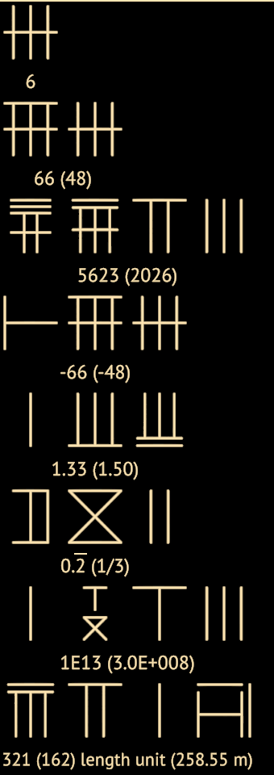

# Interface Tweaks

A [BepInEx 5](https://github.com/BepInEx/BepInEx) plugin for [Message From Aliens](https://store.steampowered.com/app/1858720/Message_From_Aliens/) with small changes to the game's interface.

## Installing

Install BepInEx first, if you haven't already, as described under [Requirements](#requirements). Then unzip the release zip into the game folder, the one that holds `MessageFromAliens.exe`. In Steam, right-click the game and choose Manage, then Browse local files, to open it. The zip holds `BepInEx/plugins/InterfaceTweaks/`, so the mod lands in BepInEx's plugins folder. To update, unzip a newer release over it. To uninstall, delete `BepInEx/plugins/InterfaceTweaks/`.

## Tweaks

* **Exit confirmation**: The exit button in the home page's top-right menu opens a confirmation page instead of quitting immediately.
* **Right-aligned settings**: On the game's settings page, each row's choices are moved to the right edge of the row, so they line up in a column instead of starting one cell after the row's name.
* **Chapter numbers**: In the chapter menus, each chapter's name is preceded by its number, with a more descriptive prefix in the chapter's heading. These match the game's achievements and Discord spoiler threshold channels.
* **Win pages**: When a chapter's wins reach certain counts, the game shows a page in the left panel, but no menu links to it, so after a restart it is gone. Each one you have unlocked is listed at the end of the menu that holds the chapter's last quiz, and opens on the right like the menu's other pages. That includes win pages that Mod Settings adds for other mods' unlock messages, once one of their lines shows. Mod Settings also adds a page for each unlock message gated on a page rather than a win count, which is listed at the end of the menu that holds that page while one of its lines shows. This tweak is off by default, since Mod Settings' unlock lines in the left panel already show what each win unlocked.
* **Quiz number values**: Once the game shows numbers' values in parentheses after them, numbers typed into a quiz's answer slots get their values too, on the label of each number's last glyph. A number is a run of adjacent slots holding digits, with an optional negative sign, repeat, or scientific form, read the way the game writes numbers.
* **Combined number labels**: Once the game shows numbers' values in parentheses after them, each number the game gives a value, and each number typed into a quiz's answer slots, gets one label centered under all of its glyphs in place of theirs. It holds the number in base 7 as its glyphs write it, with a point, a line drawn above repeating digits, and scientific form only where the glyphs use it, as in `1.2E-10`, whose exponent is also in base 7. The number's base 10 value follows in parentheses, as the game writes it, unless it reads the same, as in `10 (7)`. When a unit follows the number and the game shows that unit's value in human units, the unit joins the label too, as its translation and then that value, as in `315 (162) length unit (259 m)`. A unit after a number that follows a glyph translated as `and`, `or`, or `to` keeps its own label when the number before that glyph has no unit, since the unit belongs to both numbers, as in "1 to 2 year". A translation that lists alternatives separated by punctuation, such as `/` or `,`, counts if any of them is one of those words. While the mouse is over the number, its label, or its glyphs' labels, and while one of those labels is being edited, the glyphs' own labels show instead, so they can still be edited.
* **Units written as words**: Where the game's text writes a number and then a unit glyph as a separate word, as chapter 7 writes its dates, the unit gets the value in human units the game gives units written together with their number, such as `(-2.3E+004 y)`, from the chapter quiz wins that show those. With combined number labels, the unit then joins its number's label. Units the game gives no human value, and a unit glyph followed by another unit glyph or a per-unit glyph, which would form a unit the game has no code for, are left as they are. So is a unit after a number that follows an addition, subtraction, multiplication, division, or exponent glyph, since that unit belongs to the whole expression, as in "x ** 2 ÷ 4 length unit".
* **Lone units**: A unit glyph with no number before it, as where the text names the unit, gets the value in human units of one of that unit, from the same chapter quiz wins. Units the game gives no human value, and a unit glyph next to another unit glyph or a per-unit glyph, are left as they are. So is a unit after an answer slot, a variable, an operator, a root, or a power, whose amount is not one, and a unit the text marks as the human unit, as a chapter 3 quiz does, where the value would give away the answer.
* **Typing in notes**: While the note editor shows a note in the left panel and no text field has focus, typed English appears at the note's cursor with a list below it of up to 8 glyphs whose translations contain the text, matches at the start of a translation first, then at the start of a word in it, then elsewhere, shorter translations first. Up and Down move a selection through the list, and typing more clears it. Tab inserts the selected glyph, or the first if none is selected, at the cursor, and Enter does that and then starts a new line. Text that matches no translation is highlighted, and Tab and Enter do nothing with it. Left, Right, Home, and End move a caret within the typed text, Backspace and Delete delete the character before or after it, and Escape clears the text. With nothing typed, the arrow keys move the note's cursor, Home and End move it to the start or end of its row, Backspace and Delete remove the glyph before or after it, and Enter starts a new line, as the editor's line button does. Each insertion is a step the editor's undo button takes back. Typing is off while the calculator is open.
* **Note images**: In the note editor, a button glyph the tweak adds at the left end of the editor's buttons at the top right, in the cell they leave empty, copies an image of the whole note to the clipboard, every page of it one below the other, with its glyphs' labels as they are drawn and without the note's cursor. Clicking it while the left panel shows something else shows the note there first, as the editor's other buttons do. The pages are drawn in the left panel one at a time to be copied, under a still image of the panel as it was, so the panel does not change on screen. The image goes on the clipboard as PNG and as a bitmap, so it can be pasted into image editors, browsers, and chat programs, including Linux ones under Proton. It is not copied while the calculator is open.
* **Dictionary search**: On the dictionary page, while the left panel shows a word's definition, a button glyph the tweak adds at the left end of the buttons at the top right lists in the left panel every sentence you can see in the game so far that contains the word, each once, in the order the menus reach their pages, with the word's glyph in the results' title. That covers the pages the menus show you, as the quiz wins you have unlock them, the explanation, rule, and skill graph pages of those pages, the explanations of message and quiz pages, the welcome message, the win pages you have unlocked, and, once the note editor is unlocked, your notes. Lines other mods add to the game's pages are included. Answer slots in quiz sentences are shown as empty cells. Clicking the button again while the results show searches for the same word again. The button is left out when the title row has no cell for it.
* **Dictionary filter**: On the dictionary page, a button glyph the tweak adds at the left end of the buttons at the top right filters the dictionary by translation. Click it or press Ctrl+F, and its translation is replaced by an empty box, smaller than a quiz's answer slots, into which typed text goes. The upper panel then lists only the categories that hold a word whose translation contains the typed text, ignoring case, and the lower panel only a category's matching words. The category shown before stays shown while it holds a match, and otherwise the first one shows. The box widens to the left for longer text, and is filled in while nothing matches. Backspace deletes the last typed character. Clicking the button or Ctrl+F again empties the box and goes on taking typing, and Escape removes the box and shows the button's translation again. Leaving the dictionary page does the same. No typing is taken while a translation is being edited or while the calculator is open. The dictionary's own filter for known and unknown words still applies. The button is left out when the title row has no cell for it.
* **Compact minesweeper**: On the minesweeper board, the board's glyphs have no translations under them, and its rows are drawn without gaps between them. The solution the game shows in the left panel after a wrong answer is drawn the same way.
* **Centered minesweeper**: The minesweeper board is moved 3.5 cells right, to the middle of the right panel. With the compact board, it is also moved 1 cell down, away from the line under the page's text.
* **Minesweeper values**: The minesweeper board draws each cell worth 8 or more, other than a multiple of 7, as one glyph that joins two digits, which the game gives no value. Once the game shows numbers' values in parentheses after them, those glyphs get their values too, as in `16 (13)`.
* **Incremental game columns**: In the incremental game, where money grows over time and buys buildings, each row's parts stay in fixed columns instead of shifting as the numbers grow. The first row starts with the money glyph and then the amount, and the time and its unit start in the seventh cell. Each building's row starts with the building's glyph and then how many there are, and the price glyph is in the fifth cell, followed by the price. A part too long for its columns pushes the rest of its row right.
* **Raised underlines**: While the game's setting to hide translations is on, the lines under menu links and other underlined glyphs are drawn just below the glyphs, instead of below the hidden translations.
* **Keyboard shortcuts**: Keys for the game's own controls, each doing what clicking the control does. In the number rule game, 1 to 7, on the number row or the keypad, enter digits while the digit glyphs show. Page Up and Page Down press a panel's previous and next page glyphs. Both keys go to the same panel, one whose menu shows either glyph. When both panels' menus do, the keys go to the panel you last used: the one you last clicked in, or the left panel if its message has changed since, as when a click on the right opens an explanation on the left. Before either, they go to the right panel. On that panel's first or last page, the key whose glyph it lacks does nothing. Tab, while editing a glyph's translation, moves to the next glyph's through all of one panel's rows, its title row first, and from the end of its last row to the first glyph of the other panel's title row, wrapping around from the end of the second panel; the game's own Tab goes row by row across both panels. Shift+Tab goes the other way. Other than Tab and Shift+Tab, no shortcut works while a text field has focus, and the digits do nothing while the calculator is open, since it takes typed digits.
* **No duplicate history entries**: Right-clicking a glyph whose information the left panel already shows, such as right-clicking the same glyph twice, adds no second, identical entry to the left panel's history. The game skips such a push for other pages, but stores a glyph's information with a different separator than it compares with, so it misses these. With Calculator's calculator open, the right-click still closes it and shows the entry.
* **Undo translations**: Left Ctrl+Z, by default (the `Undo.Shortcut` setting), undoes the latest translation change and returns to the screen it was made on: the right panel's page, the left panel's message and its page, and the dictionary's category and filter. Undo repeats back through earlier changes. Changes that other mods save in the game's dictionary are included too, except Mod Settings' record of the unlock messages it has shown. A change can't be undone once the right panel can't be drawn again as it was, as after a move in a game; pressing the shortcut then drops that change and keeps older ones. While the note editor has a different note open than when the change was made, or the note was edited since, undo reverts the translation without changing the screen. The shortcut does nothing while a label is being edited.

Each minesweeper tweak has a row of glyphs in the board page's bottom-right corner, its name and then yes or no, that turns it on and off.



Combined number labels: each number's base 7 value, with its base 10 value in parentheses.


The minesweeper board, compact and centered, with the tweaks' toggles in its bottom-right corner.

## Configuration

`BepInEx/config/sparr.messagefromaliens.interfacetweaks.cfg`, created on first launch:

| Key | Default | Effect |
|---|---|---|
| `ExitConfirmation.Enabled` | `true` | Ask before the exit button quits the game. |
| `Settings.RightAlignChoices` | `true` | Line up settings rows' choices at the right edge. |
| `Chapters.Numbers` | `true` | Number the chapters in the chapter menus and chapter titles, as the chapter achievements do. |
| `Chapters.WinPages` | `false` | List the unlocked win pages at the end of each chapter's menu, and Mod Settings' pages for unlock messages gated on a page at the end of that page's menu. |
| `Quizzes.NumberValues` | `true` | Show the values of numbers typed into quiz answers, once the game shows numbers' values. |
| `Numbers.CombinedLabels` | `true` | Give each number one label with its value in base 7 and base 10, and its unit, once the game shows numbers' values. |
| `Numbers.WordUnits` | `true` | Give a unit written as a separate word after a number the game's value in human units. |
| `Numbers.LoneUnits` | `true` | Give a unit glyph with no number before it the value of one of that unit in human units. |
| `Notes.TypeGlyphs` | `true` | Type English in the note editor to insert glyphs by their translations, and move the note's cursor with the arrow, Home, and End keys. |
| `Notes.ImageButton` | `true` | Show the note editor's button that copies an image of the whole note. |
| `Dictionary.TypeFilter` | `true` | Show the dictionary page's filter button, which with Ctrl+F starts typing a filter of the dictionary to words whose translations contain the typed text. |
| `Dictionary.SearchButton` | `true` | Show the dictionary page's button that lists the sentences containing the word whose definition the left panel shows. |
| `Minesweeper.CompactBoard` | `true` | Hide the translations of the minesweeper board and its solution, and close the gaps between their rows. |
| `Minesweeper.CenterBoard` | `true` | Move the minesweeper board to the middle of the right panel, and with the compact board, 1 cell down. |
| `Incremental.FixedColumns` | `true` | Put each row's parts in the incremental game in fixed columns, so they stay in place as the numbers grow. |
| `Underlines.RaiseWhenLabelsHidden` | `true` | While translations are hidden, draw underlines just below the glyphs. |
| `Keys.Shortcuts` | `true` | Keyboard shortcuts for the game's own controls: digits in the number rule game, Page Up and Page Down for a panel's pages, and Tab and Shift+Tab through one panel's labels at a time. |
| `History.SkipDuplicates` | `true` | Add no left panel history entry that is the same as the one shown, which the game adds when a glyph is right-clicked twice. |
| `Undo.Enabled` | `true` | Keep a list of translation changes that the undo shortcut undoes. |
| `Undo.Shortcut` | `Z + LeftControl` | The undo shortcut, as BepInEx writes keyboard shortcuts. |

Each setting except `Undo.Shortcut` is tagged with its name in glyphs, and the mod names itself in glyphs, so Mod Settings can show them in the game. Mod Settings would show the shortcut as English key names in a text field, where a mistyped value would silently unbind undo.

Mod Settings lists each setting once the game has unlocked what it is for, as the game decides from quiz wins, with chapters numbered as the chapter achievements are. `Quizzes.NumberValues` and `Numbers.CombinedLabels` are listed once the game can show numbers' values, after 11 quiz wins in chapter 1. `Numbers.WordUnits` and `Numbers.LoneUnits` are listed once the game can show any unit's value in human units, after 5 quiz wins in chapter 3, 3 in optional chapter 4, or 2 in optional chapter 5. `Chapters.WinPages` is listed once the first win page has shown, and `Dictionary.SearchButton` and `Dictionary.TypeFilter` once the dictionary is unlocked, all after 3 quiz wins in chapter 1. `Notes.TypeGlyphs` and `Notes.ImageButton` are listed once the note editor is unlocked, the minesweeper settings once the minesweeper game is, and `Incremental.FixedColumns` once the incremental game is, after 3 quiz wins in chapter 2. The other settings are for parts of the game that are there from the start, and are always listed.

Each gated setting also declares its feature's words in glyphs, from which Mod Settings writes the game's own unlock sentences: a line in the explanation of the chapter whose quiz wins unlock it, shown from the start, and a line on the page the game shows in the left panel at that win count. `Numbers.WordUnits` and `Numbers.LoneUnits` have these in each of their three chapters. The note editor's lines go in the home page's explanation. The gates and messages need a Mod Settings that reads gate tokens combining terms with `|` and builds unlock sentences from a feature's words.

## Requirements

- BepInEx 5.4.23.6 or later, `BepInEx_win_x64` build, unzipped into the game folder. Tested with Unity 6000.6.8f1.
- On Linux under Proton, set the Steam launch options to `WINEDLLOVERRIDES="winhttp=n,b" %command%`.
- Optional: [Mod Settings](https://github.com/sparr/messagefromaliens-mod-ModSettings) 0.2.0 or later, to change settings in the game, list each once the game unlocks what it is for, and show unlock messages.
- Optional: [Calculator](https://github.com/sparr/messagefromaliens-mod-Calculator), any version. Some tweaks hold back while its calculator is open, as described above.
- .NET SDK 8 or later to build.

## Building

```sh
dotnet build -c Release
```

With `-p:DeployToGame=true`, the build also copies `InterfaceTweaks.dll` to `<game>/BepInEx/plugins/InterfaceTweaks/`.

The build looks for the game in `<SteamLibraryDir>/steamapps/common/Message From Aliens`. `SteamLibraryDir` comes from the first of these that is set:

1. `-p:SteamLibraryDir=/path/to/SteamLibrary` on the command line.
2. A `SteamLibraryDir` environment variable.
3. `GamePaths.props`, a copy of `GamePaths.props.example`. It is ignored by git.
4. Steam's default install location: `~/.local/share/Steam` on Linux, `C:\Program Files (x86)\Steam` on Windows.

For a game folder outside a Steam library, set `GameDir` to the game folder the same ways.

## Patches

Several tweaks patch some of the same methods. Each such method is patched by one class in `src/Patches.cs`, with a patch method for each kind and priority, which runs each tweak's part in the order given here.

| Method | Patch |
|---|---|
| `Draw.Update` | Prefix, in this order. Keyboard shortcuts: records which half of the screen the mouse last clicked in, or the left panel when its message changed since the last frame. On the shortcut keys, enters a digit in the number rule game, or, for a page key, turns the page of the panel that gets the page keys if its menu shows that key's page glyph, as clicking does. Minesweeper toggles: a left click on a toggle flips its setting. Typing in notes: in the note editor, reads typed text and the arrow, Home, End, Tab, Enter, Backspace, Delete, and Escape keys, and inserts glyphs and new lines or moves the note's cursor. Note images: a left click on the note image button starts drawing each of the note's pages without its cursor, reading each from the screen at the end of the frame and then drawing the left half of the screen as it was over it, and then puts the stacked pages on the clipboard and shows the page shown before again. Dictionary search: notes a left click on the search button. Dictionary filter: on the dictionary page, on Ctrl+F or a left click on the filter button clears the typed text and starts taking typing, while taking it adds typed characters, removes one on Backspace, and on Escape clears it and stops, redrawing after a change, and off the dictionary page clears it. Undo: on the undo shortcut, writes the latest change's old values back, restores its screen, and redraws. If the right panel's glyphs differ from the screen's, reverts the undo and drops that change. |
| `Draw.Update` | Prefix (last), postfix (first), and finalizer: mark the game's own `Update` as running, and as done even if it throws, so the `Camera.ScreenToWorldPoint` patch applies only to the game's mouse tests. |
| `Draw.Update` | Postfix, in this order. Typing in notes: draws the typed text and the list of matching glyphs at the note's cursor. Combined number labels: shows a number's own labels while the mouse is over it or one of them is being edited, and combines them again after, and draws the lines above repeating digits where TMP laid them out. Dictionary search: after a left click on the search button, while Calculator still counts the frame as a click, pushes the sentences containing the selected word to the left panel and redraws. Dictionary filter: while it takes typing, hides the filter button's label and draws a box over it with the typed text, which takes clicks so the label cannot be edited, and afterward shows the label again. |
| `Draw.Update` | Transpiler: replaces the game's check for Tab with one that, while keyboard shortcuts are on, moves from the selected label to the next or, with Shift, the previous one in panel order, and tells the game no Tab was pressed. |
| `Draw.UpdateText1` | Prefix, in this order. Minesweeper layout: returns the board's glyphs to their usual positions. Combined number labels: shows the labels that combined number labels hid, before the redraw reuses the glyphs. Undo: notes which dictionary page was shown before the redraw changes it. |
| `Draw.UpdateText1` | Postfix, in this order. Minesweeper layout: on the board and the left panel's solution page, hides the board's translations and moves its rows up to close the gaps when compact, and on the board, moves its glyphs and the cells' frames when centered and moves the frames' rows together when compact. Minesweeper toggles: on the minesweeper board, draws a toggle for each minesweeper tweak in the bottom-right corner. |
| `Draw.UpdateText1` | Postfix (late), combined number labels: finds the drawn numbers and their units, puts each one's combined label on the first glyph of its widest row, and hides its other glyphs' labels. |
| `Draw.UpdateText1` | Postfix (last), undo: records the navigation state and the right panel's glyphs, as the screen of later changes. |
| `Draw.Write` | Prefix, in this order. Chapter numbers: in the chapter menus and a chapter's title, adds the chapter's number before its name, and in the title the glyphs for its menu. Note images: in the note editor's right menu, adds the note image button at its left end. Dictionary search: on the dictionary page, while the left panel shows a word's definition or its search results and the title row has a cell to spare, adds the search button at the right menu's left end. Dictionary filter: on the dictionary page, while the title row has a cell to spare, adds the filter button at the right menu's left end. Quiz number values: notes that the page's answer slots are being drawn. Incremental game columns: on the incremental game's page, moves the money glyph before the amount and each building's glyph before its count, and the price glyph before the price, and fills the gaps with empty cells so the time starts in the seventh cell and the price glyph is in the fifth. Right-aligned settings: on the settings page and pages opened from it, fills each choice row's gap with empty cells up to the row's width of 12. Units written as words and lone units: after a number with a value token, inserts the unit token `Global.StringToListString` would have made before the last glyph of a unit written as a separate word, unless an operator glyph comes before the number, and before the last glyph of a unit with no number before it, the token for one of the unit. Raised underlines: notes how many lines the game has drawn so far. |
| `Draw.Write` | Postfix, in this order. Chapter numbers: removes the added glyphs from the drawn lines' link targets, and highlights the lines of chapters that contain the marked word, which the game's own check misses because of the added glyphs. Quiz number values: adds the values of numbers in the page's quiz answer slots to their labels. |
| `Draw.Write` | Finalizer, raised underlines: while translations are hidden, moves the underlines the call added up to just below their glyphs. |
| `AlienCharacter.UpdateEarthText` | Postfix, quiz number values: adds the value again when the game rewrites the label of the glyph that ends a number in the answer slots. |
| `AlienCharacter.UpdateEarthText` | Postfix (late), combined number labels: when the game rewrites the label of a glyph in a combined number, puts back the combined label or hides the label again. |
| `Global.GetInfo` | Prefix, exit confirmation: supplies the confirmation page's lines and its explanation. Postfix, win pages: adds the chapter's unlocked win pages that have text to the end of the menu that holds its last quiz, and Mod Settings' pages for page-gated unlock messages that have text to the end of the menu that holds their page. |
| `Draw.ToParentPage` | Prefix: when only the home page is on the page stack, where the game would quit, opens the confirmation page instead. |
| `Draw.ToPage` | Prefix: on the confirmation page, quits for the yes line and returns to the home page for the no line. |
| `Draw.CurrentPageIsMenu` | Postfix: true on the confirmation page, so its lines are drawn, highlighted, and clicked like a menu's. |
| `Global.UpdateDict` | Postfix, dictionary filter: on the dictionary page, with typed text, keeps only the words whose translations contain it, in entries of up to 48 per category as the game splits them, and drops categories left empty. After the text changes, shows the category shown before if it is still listed, or else the first, and keeps the game from switching to the category of the left panel's word. |
| `Global.GetWin` | Postfix: true for an unlocked win page, so its menu line shows as done, the menu can still be won, and reading the page records no win. |
| `Global.SetWin` | Prefix: skips win pages, so they never add to a chapter's win count. |
| `Draw.ResetTextPosition` | Postfix: after the game puts every label back under its glyph, which it does on most frames, widens each combined number label to span its row of the number. |
| `Camera.ScreenToWorldPoint(Vector3)` | Postfix: during the game's `Draw.Update` on the minesweeper board, maps the mouse's point on the compact or moved board back to the game's layout, so clicks and hovering find the cell drawn under the mouse. |
| `HardwareCursor.Apply` | Prefix: gives the minesweeper toggles the game's button cursor when the mouse is over them. |
| `Global.StringToListString` | Postfix: puts a value token before each glyph that joins two digits into one minesweeper cell, as the game puts before other whole numbers. |
| `Draw.PushLeftText` | Prefix, after other mods' prefixes, Calculator's and Compound Translations' included: skips a push whose entry, joined as the game would store it, is the left panel's current entry. |
| `Global.SaveGame` | Prefix: compares the dictionary with its copy from the last save, and pushes any changed translations onto the undo stack with the screen of the last redraw. |
| `Global.LoadGame` | Finalizer: clears the undo stack, also when the load throws after replacing the save. |
