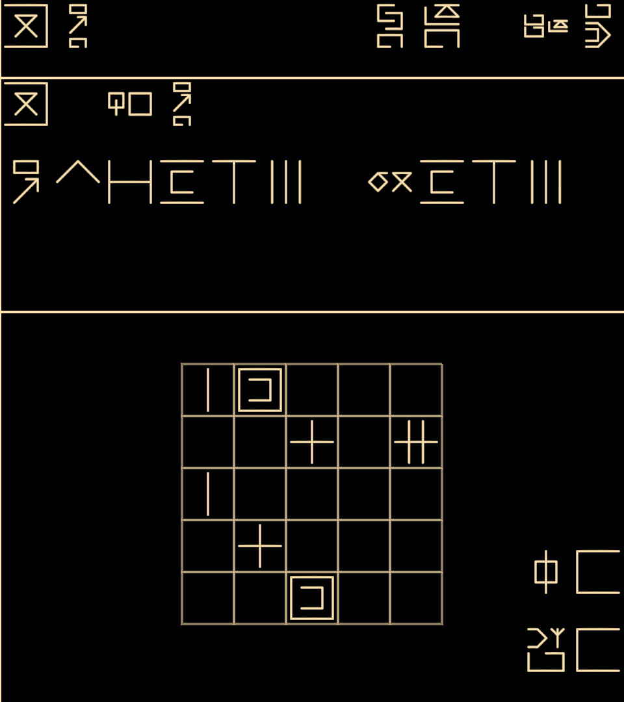

# Interface Tweaks

A [BepInEx 5](https://github.com/BepInEx/BepInEx) plugin for [Message From Aliens](https://store.steampowered.com/app/1858720/Message_From_Aliens/) with small changes to the game's interface.

## Installing

Install BepInEx first, if you haven't already, as described under [Requirements](#requirements). Then unzip the release zip into the game folder, the one that holds `MessageFromAliens.exe`. In Steam, right-click the game and choose Manage, then Browse local files, to open it. The zip holds `BepInEx/plugins/InterfaceTweaks/`, so the mod lands in BepInEx's plugins folder. To update, unzip a newer release over it. To uninstall, delete `BepInEx/plugins/InterfaceTweaks/`.

## Tweaks

**!!SPOILER WARNING!!** The below sections describe game content that is not unlocked at the start of the game. I recommend just playing to discover the new features as they become available. Reading beyond here will spoil parts of the game.

* **Exit confirmation**: Add a confirmation page when you click That Button.
* **Right-aligned settings**: Split the settings page: left side setting names, right side options.
* **Chapter numbers**: Add numbers to chapter titles.
* **Win pages**: Add new pages to the end of each chapter with copies of the ephemeral "you unlocked something" pages. Off by default.
* **Quiz number values**: Apply the vanilla number value calculation to quiz answers.
* **Combined number labels**: After unlocking vanilla numbers-in-parentheses, get rid of all the individual number glyph translations and provide a single combined translation/conversion/units for a whole value.
* **Units written as words**: Make number+unit render consistently.
* **Lone units**: Apply vanilla unit calculations to unit names written without a value, assuming 1.
* **Typing in notes**: Type your own translations into the notebook editor and get autocomplete for the matching glyphs.
* **Note images**: Add a button to the notebook to take a clipboard "screenshot" of a full notebook entry, combining pages, omitting the rest of the interface.
* **Dictionary search**: Add a button to the dictionary to find every sentence containing the selected word.
* **Dictionary filter**: Add a button (and Ctrl+f hotkey) to the dictionary to search your translations and filter the dictionary entries.
* **Compact minesweeper**: Draw the minesweeper board (and solution) without translations or gaps.
* **Centered minesweeper**: Draw the minesweeper board in the middle of its panel.
* **Minesweeper values**: Extend vanilla numeric handling to the compound number glyphs used in minesweeper.
* **Incremental game columns**: Change the layout in the incremental game to better align the columns and keep the buttons from jumping around.
* **Raised underlines**: When translations are hidden, move the "clickable" underline indicator up closer to the glyph.
* **Keyboard shortcuts**: Add various keyboard shortcuts to the existing game interfaces. Page Up and Down for page navigation, digits in one of the games, Shift+Tab as the opposite of Tab (and changing the cycle order for Tab), etc.
* **No duplicate history entries**: Don't add the same page to the left panel history multiple times in a row.
* **Undo translations**: Ctrl+Z to undo translation changes and return to the screen where the change was made. Drops and skips undoing changes that can't be shown on-screen, e.g. one that requires returning to a previous game state.


Combined number labels: each number's base 7 value, with its base 10 value in parentheses.



The minesweeper board, compact and centered, with the tweaks' toggles in its bottom-right corner.

## Configuration

`BepInEx/config/sparr.messagefromaliens.interfacetweaks.cfg`, created on first launch:

| Key | Default | Effect |
|---|---|---|
| `ExitConfirmation.Enabled` | `true` | Ask before the exit button quits the game. |
| `Settings.RightAlignChoices` | `true` | Line up settings rows' choices at the right edge. |
| `Chapters.Numbers` | `true` | Number the chapters in the chapter menus and chapter titles, as the chapter achievements do. |
| `Chapters.WinPages` | `false` | List the unlocked win pages at the end of each chapter's menu, and Mod Settings' pages for unlock messages gated on a page at the end of that page's menu. |
| `Quizzes.NumberValues` | `true` | Show the values of numbers typed into quiz answers, once the game shows numbers' values. |
| `Numbers.CombinedLabels` | `true` | Give each number one label with its value in base 7 and base 10, and its unit, once the game shows numbers' values. |
| `Numbers.WordUnits` | `true` | Give a unit written as a separate word after a number the game's value in human units. |
| `Numbers.LoneUnits` | `true` | Give a unit glyph with no number before it the value of one of that unit in human units. |
| `Notes.TypeGlyphs` | `true` | Type English in the notebook editor to insert glyphs by their translations, and move the note's cursor with the arrow, Home, and End keys. |
| `Notes.ImageButton` | `true` | Show the notebook editor's button that copies an image of the whole note. |
| `Dictionary.TypeFilter` | `true` | Show the dictionary page's filter button, which with Ctrl+F starts typing a filter of the dictionary to words whose translations contain the typed text. |
| `Dictionary.SearchButton` | `true` | Show the dictionary page's button that lists the sentences containing the word whose definition the left panel shows. |
| `Minesweeper.CompactBoard` | `true` | Hide the translations of the minesweeper board and its solution, and close the gaps between their rows. |
| `Minesweeper.CenterBoard` | `true` | Move the minesweeper board to the middle of the right panel, and with the compact board, 1 cell down. |
| `Incremental.FixedColumns` | `true` | Put each row's parts in the incremental game in fixed columns, so they stay in place as the numbers grow. |
| `Underlines.RaiseWhenLabelsHidden` | `true` | While translations are hidden, draw underlines just below the glyphs. |
| `Keys.Shortcuts` | `true` | Keyboard shortcuts for the game's own controls: digits in the number rule game, Page Up and Page Down for a panel's pages, and Tab and Shift+Tab through one panel's labels at a time. |
| `History.SkipDuplicates` | `true` | Add no left panel history entry that is the same as the one shown, which the game adds when a glyph is right-clicked twice. |
| `Undo.Enabled` | `true` | Keep a list of translation changes that the undo shortcut undoes. |
| `Undo.Shortcut` | `Z + LeftControl` | The undo shortcut, as BepInEx writes keyboard shortcuts. (Only available in cfg file) |

Some in-game settings are locked until the vanilla game unlock that affects them.

## Requirements

- BepInEx 5.4.23.6 or later, `BepInEx_win_x64` build, unzipped into the game folder. Tested with Unity 6000.6.8f1.
- On Linux under Proton, set the Steam launch options to `WINEDLLOVERRIDES="winhttp=n,b" %command%`.
- Optional: [Mod Settings](https://github.com/sparr/messagefromaliens-mod-ModSettings) 0.2.0 or later, to change settings in the game, list each once the game unlocks what it is for, and show unlock messages.
- Optional: [Calculator](https://github.com/sparr/messagefromaliens-mod-Calculator), any version. Some tweaks hold back while its calculator is open.
- .NET SDK 8 or later to build.

## Building

```sh
dotnet build -c Release
```

With `-p:DeployToGame=true`, the build also copies `InterfaceTweaks.dll` to `<game>/BepInEx/plugins/InterfaceTweaks/`.

The build looks for the game in `<SteamLibraryDir>/steamapps/common/Message From Aliens`. `SteamLibraryDir` comes from the first of these that is set:

1. `-p:SteamLibraryDir=/path/to/SteamLibrary` on the command line.
2. A `SteamLibraryDir` environment variable.
3. `GamePaths.props`, a copy of `GamePaths.props.example`. It is ignored by git.
4. Steam's default install location: `~/.local/share/Steam` on Linux, `C:\Program Files (x86)\Steam` on Windows.

For a game folder outside a Steam library, set `GameDir` to the game folder the same ways.

## Patches

Several tweaks patch some of the same methods. Each such method is patched by one class in `src/Patches.cs`, with a patch method for each kind and priority, which runs each tweak's part in the order given here.

| Method | Patch |
|---|---|
| `Draw.Update` | Prefix, in this order. Keyboard shortcuts: records which half of the screen the mouse last clicked in, or the left panel when its message changed since the last frame. On the shortcut keys, enters a digit in the number rule game, or, for a page key, turns the page of the panel that gets the page keys if its menu shows that key's page glyph, as clicking does. Minesweeper toggles: a left click on a toggle flips its setting. Typing in notes: in the notebook editor, reads typed text and the arrow, Home, End, Tab, Enter, Backspace, Delete, and Escape keys, and inserts glyphs and new lines or moves the note's cursor. Note images: a left click on the note image button starts drawing each of the note's pages without its cursor, reading each from the screen at the end of the frame and then drawing the left half of the screen as it was over it, and then puts the stacked pages on the clipboard and shows the page shown before again. Dictionary search: notes a left click on the search button. Dictionary filter: on the dictionary page, on Ctrl+F or a left click on the filter button clears the typed text and starts taking typing, while taking it adds typed characters, removes one on Backspace, and on Escape clears it and stops, redrawing after a change, and off the dictionary page clears it. Undo: on the undo shortcut, writes the latest change's old values back, restores its screen, and redraws. If the right panel's glyphs differ from the screen's, reverts the undo and drops that change. |
| `Draw.Update` | Prefix (last), postfix (first), and finalizer: mark the game's own `Update` as running, and as done even if it throws, so the `Camera.ScreenToWorldPoint` patch applies only to the game's mouse tests. |
| `Draw.Update` | Postfix, in this order. Typing in notes: draws the typed text and the list of matching glyphs at the note's cursor. Combined number labels: shows a number's own labels while the mouse is over it or one of them is being edited, and combines them again after, and draws the lines above repeating digits where TMP laid them out. Dictionary search: after a left click on the search button, while Calculator still counts the frame as a click, pushes the sentences containing the selected word to the left panel and redraws. Dictionary filter: while it takes typing, hides the filter button's label and draws a box over it with the typed text, which takes clicks so the label cannot be edited, and afterward shows the label again. |
| `Draw.Update` | Transpiler: replaces the game's check for Tab with one that, while keyboard shortcuts are on, moves from the selected label to the next or, with Shift, the previous one in panel order, and tells the game no Tab was pressed. |
| `Draw.UpdateText1` | Prefix, in this order. Minesweeper layout: returns the board's glyphs to their usual positions. Combined number labels: shows the labels that combined number labels hid, before the redraw reuses the glyphs. Undo: notes which dictionary page was shown before the redraw changes it. |
| `Draw.UpdateText1` | Postfix, in this order. Minesweeper layout: on the board and the left panel's solution page, hides the board's translations and moves its rows up to close the gaps when compact, and on the board, moves its glyphs and the cells' frames when centered and moves the frames' rows together when compact. Minesweeper toggles: on the minesweeper board, draws a toggle for each minesweeper tweak in the bottom-right corner. |
| `Draw.UpdateText1` | Postfix (late), combined number labels: finds the drawn numbers and their units, puts each one's combined label on the first glyph of its widest row, and hides its other glyphs' labels. |
| `Draw.UpdateText1` | Postfix (last), undo: records the navigation state and the right panel's glyphs, as the screen of later changes. |
| `Draw.Write` | Prefix, in this order. Chapter numbers: in the chapter menus and a chapter's title, adds the chapter's number before its name, and in the title the glyphs for its menu. Note images: in the notebook editor's right menu, adds the note image button at its left end. Dictionary search: on the dictionary page, while the left panel shows a word's definition or its search results and the title row has a cell to spare, adds the search button at the right menu's left end. Dictionary filter: on the dictionary page, while the title row has a cell to spare, adds the filter button at the right menu's left end. Quiz number values: notes that the page's answer slots are being drawn. Incremental game columns: on the incremental game's page, moves the money glyph before the amount and each building's glyph before its count, and the price glyph before the price, and fills the gaps with empty cells so the time starts in the seventh cell and the price glyph is in the fifth. Right-aligned settings: on the settings page and pages opened from it, fills each choice row's gap with empty cells up to the row's width of 12. Units written as words and lone units: after a number with a value token, inserts the unit token `Global.StringToListString` would have made before the last glyph of a unit written as a separate word, unless an operator glyph comes before the number, and before the last glyph of a unit with no number before it, the token for one of the unit. Raised underlines: notes how many lines the game has drawn so far. |
| `Draw.Write` | Postfix, in this order. Chapter numbers: removes the added glyphs from the drawn lines' link targets, and highlights the lines of chapters that contain the marked word, which the game's own check misses because of the added glyphs. Quiz number values: adds the values of numbers in the page's quiz answer slots to their labels. |
| `Draw.Write` | Finalizer, raised underlines: while translations are hidden, moves the underlines the call added up to just below their glyphs. |
| `AlienCharacter.UpdateEarthText` | Postfix, quiz number values: adds the value again when the game rewrites the label of the glyph that ends a number in the answer slots. |
| `AlienCharacter.UpdateEarthText` | Postfix (late), combined number labels: when the game rewrites the label of a glyph in a combined number, puts back the combined label or hides the label again. |
| `Global.GetInfo` | Prefix, exit confirmation: supplies the confirmation page's lines and its explanation. Postfix, win pages: adds the chapter's unlocked win pages that have text to the end of the menu that holds its last quiz, and Mod Settings' pages for page-gated unlock messages that have text to the end of the menu that holds their page. |
| `Draw.ToParentPage` | Prefix: when only the home page is on the page stack, where the game would quit, opens the confirmation page instead. |
| `Draw.ToPage` | Prefix: on the confirmation page, quits for the yes line and returns to the home page for the no line. |
| `Draw.CurrentPageIsMenu` | Postfix: true on the confirmation page, so its lines are drawn, highlighted, and clicked like a menu's. |
| `Global.UpdateDict` | Postfix, dictionary filter: on the dictionary page, with typed text, keeps only the words whose translations contain it, in entries of up to 48 per category as the game splits them, and drops categories left empty. After the text changes, shows the category shown before if it is still listed, or else the first, and keeps the game from switching to the category of the left panel's word. |
| `Global.GetWin` | Postfix: true for an unlocked win page, so its menu line shows as done, the menu can still be won, and reading the page records no win. |
| `Global.SetWin` | Prefix: skips win pages, so they never add to a chapter's win count. |
| `Draw.ResetTextPosition` | Postfix: after the game puts every label back under its glyph, which it does on most frames, widens each combined number label to span its row of the number. |
| `Camera.ScreenToWorldPoint(Vector3)` | Postfix: during the game's `Draw.Update` on the minesweeper board, maps the mouse's point on the compact or moved board back to the game's layout, so clicks and hovering find the cell drawn under the mouse. |
| `HardwareCursor.Apply` | Prefix: gives the minesweeper toggles the game's button cursor when the mouse is over them. |
| `Global.StringToListString` | Postfix: puts a value token before each glyph that joins two digits into one minesweeper cell, as the game puts before other whole numbers. |
| `Draw.PushLeftText` | Prefix, after other mods' prefixes, Calculator's and Compound Translations' included: skips a push whose entry, joined as the game would store it, is the left panel's current entry. |
| `Global.SaveGame` | Prefix: compares the dictionary with its copy from the last save, and pushes any changed translations onto the undo stack with the screen of the last redraw. |
| `Global.LoadGame` | Finalizer: clears the undo stack, also when the load throws after replacing the save. |
